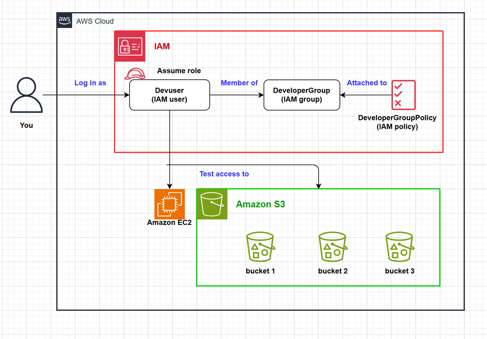
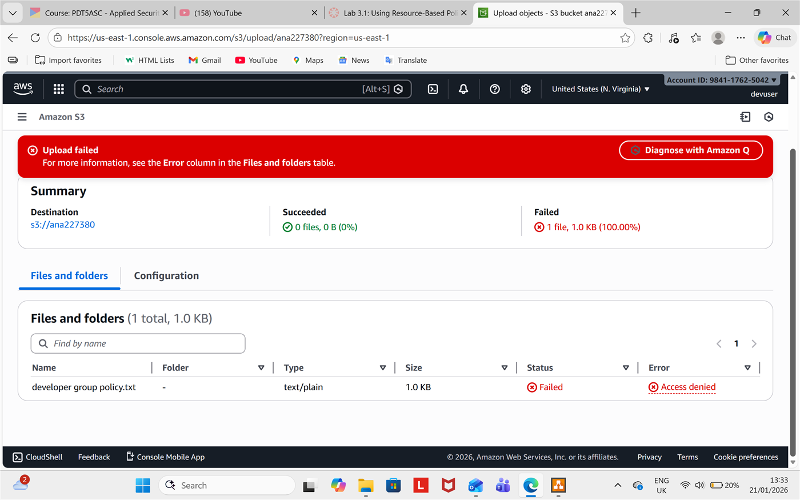
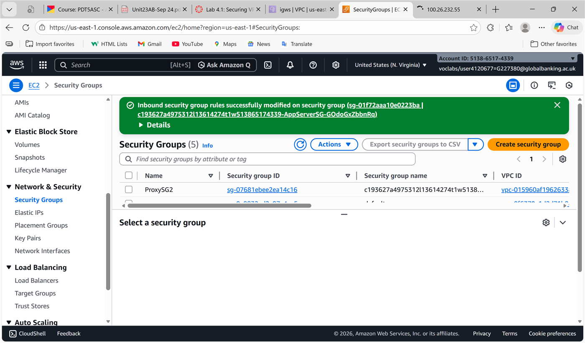

# AWS Cloud Security Deployment & Monitoring

**Grade: Distinction** · Unit 23: Applied Security in the Cloud · 2026

## The problem

Inspire Tech Solutions (fictional), a Manchester retail technology company, stores customer and payment data in AWS. It faced the classic cloud risks: identity compromise, misconfigured storage and networks, insider misuse and no real-time visibility of attacks.

## What I did

1. **Designed least-privilege access.** IAM users get permissions only through groups, and a developer can assume a role for temporary elevated access. S3 bucket policies add a second layer of protection.

   

2. **Benchmarked and penetration-tested S3 storage.**

   | Threat simulated | Control validated |
   |---|---|
   | Unauthorised object access | IAM least privilege, bucket policies |
   | Accidental public bucket | S3 Block Public Access, bucket ACLs |
   | Malicious object upload | IAM deny-write, CloudTrail logging |
   | Hidden access attempts | CloudTrail → CloudWatch Logs |
   | Privilege escalation via roles | IAM role trust policies |

   An upload attempt without permission was blocked as designed:

   

3. **Tested VPC network controls.** I changed security group rules to simulate an attacker, blocked HTTP with a network ACL deny rule, and checked routing between public and private subnets (NAT gateway vs internet gateway).

   

4. **Built real-time monitoring and alerting.**
   - CloudTrail logs every API call.
   - CloudWatch Logs centralises the logs for investigation with Logs Insights.
   - CloudWatch Alarms detect brute-force and traffic spikes.
   - EventBridge catches risky changes, such as security group edits, the moment they happen.
   - SNS emails the alert to a person.

## Why this design

I tested the design against four real AWS breaches:

| Breach | Root cause | How this design responds |
|---|---|---|
| Capital One (2019) | Misconfigured firewall, S3 data stolen | EventBridge + SNS alert on security group changes |
| Code Spaces (2014) | Weak IAM, attacker deleted everything | CloudWatch Alarms on failed logins, CloudTrail audit |
| Tesla (2018) | Exposed console, cryptojacking | CloudWatch CPU and network spike alarms |
| Uber (2016) | AWS keys leaked on GitHub | Least privilege limits what a leaked key can do |

## Skills shown

AWS IAM · S3 · VPC · security groups & NACLs · CloudTrail · CloudWatch · EventBridge · SNS · penetration testing · NIST SP 800-53
