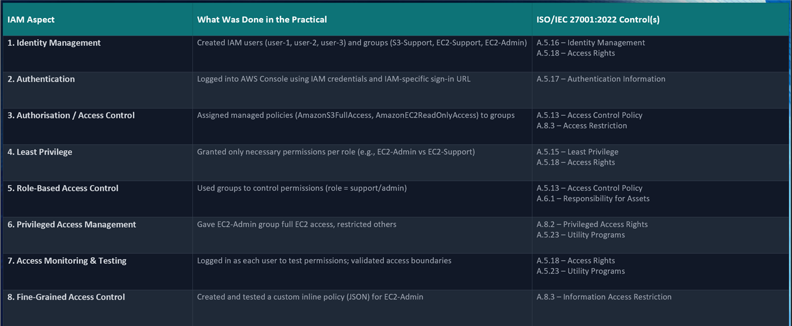
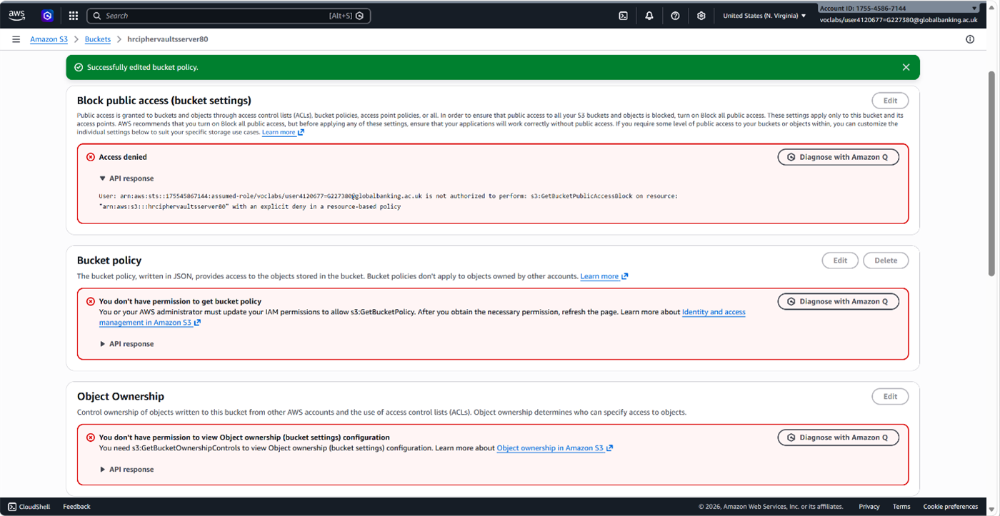

# Cloud-Based ISMS Aligned to ISO 27001

**Grade: Merit** · Unit 25: Information Security Management in the Cloud · 2026

## The problem

Cipher-Vaults Dynamics (fictional), a UK e-commerce company, moved customer personal and payment data to AWS. An incident then showed four gaps:

- No MFA on any IAM account
- Publicly accessible S3 bucket policies
- No CloudTrail logging or threat detection
- No information security management system (ISMS), incident response plan or staff awareness training

## What I did

1. **Wrote the business case** for AWS Security Hub with GuardDuty, CloudTrail, IAM Identity Center and Macie as a cloud-native ISMS. It included a SWOT analysis and a business impact analysis: downtime of £8,000–£15,000 per hour against a year-one investment of about £80K–£120K.
2. **Compared four options:** AWS Security Hub (recommended), Microsoft's ISMS, SureCloud and Alliantist ISMS.online.
3. **Planned a four-phase rollout:**

   | Phase | Timing | Key actions |
   |---|---|---|
   | 1. Emergency controls | 0–30 days | MFA for all users, S3 Block Public Access, CloudTrail in all regions, AWS Config |
   | 2. Core ISMS | 30–60 days | GuardDuty, Security Hub, Macie, IAM Access Analyzer, incident response plan |
   | 3. Governance & culture | 60–90 days | Awareness training, Amazon Inspector, board-approved policies, DPIA |
   | 4. Certification | 90+ days | ISO 27001 gap analysis, NCSC CAF assessment, certification by month 18 |

4. **Completed 5 hands-on AWS labs** and mapped each one to ISO/IEC 27001, 27002 and 27017 controls. The labs covered IAM, Systems Manager, and encrypted, access-restricted S3 buckets for HR, Finance and Customer data.

   

   

## Skills shown

ISO 27001 / 27017 · UK GDPR · PCI DSS · NCSC CAF · business impact analysis · AWS Security Hub · GuardDuty · Macie · IAM · Systems Manager · S3 encryption (AES-256)
