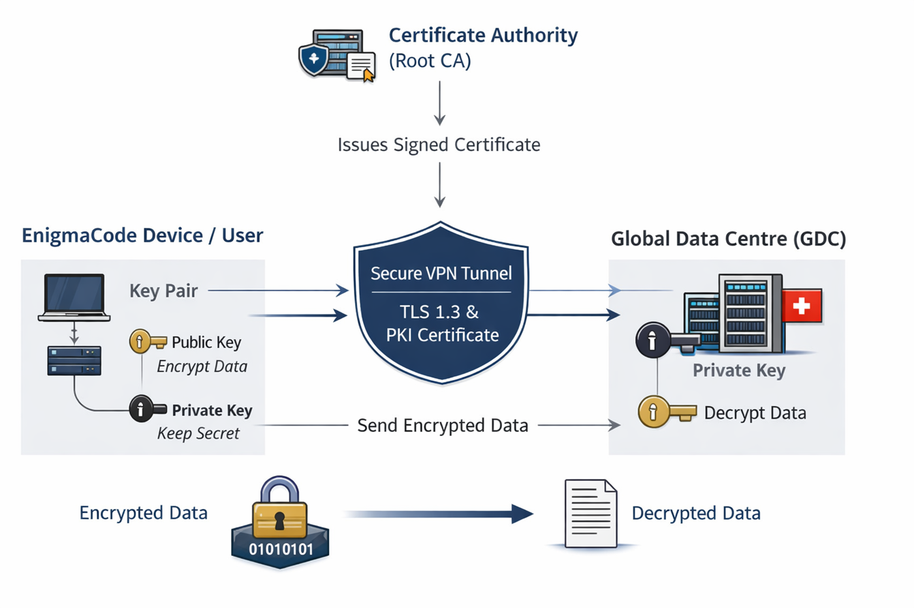
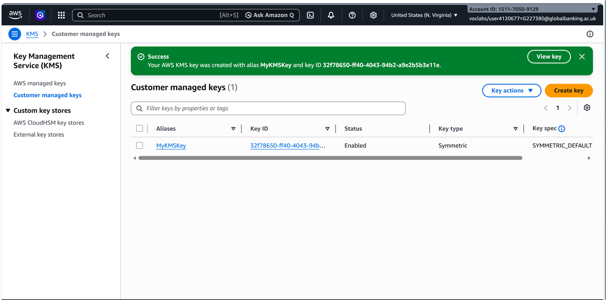

# Cloud Cryptography for a Global VPN

**Grade: Merit** · Unit 24: Applied Cryptography in the Cloud · 2026

## The problem

EnigmaCode Systems (fictional) connects offices in 10 countries to a data centre in Switzerland over a VPN. Its blueprints, R&D files and financial records had no encryption at rest, no certificate-based authentication, no key rotation and no audit logging.

## What I did

1. **Designed a PKI for the VPN.** A certificate authority issues device certificates, so only trusted devices can open a TLS 1.3 tunnel to the data centre.

   

2. **Lab 1 — encryption at rest.** I created a customer-managed AWS KMS key and used it for S3 server-side encryption (SSE-KMS) and EBS volume encryption. CloudTrail logged every key use. Disabling the key made the encrypted data unreadable straight away.

   

3. **Lab 2 — secure delivery.** I added CloudFront caching over HTTPS and AWS WAF rules that restrict access by IP, for both the website and a REST API.
4. **Lab 3 — authentication.** I added Amazon Cognito sign-in. API Gateway checks the user's token before Lambda and Step Functions run the report workflow.
5. **Analysed the theory behind it:** stream vs block ciphers (implemented by hand to encrypt and decrypt data), the risks in public-key encryption, and KEM/DEM/PKE schemes.

## Recommendations I made

- MFA for all data centre access
- Automated key rotation and certificate renewal
- Zero Trust network access for global offices
- Planning for post-quantum cryptography

## Skills shown

PKI · TLS 1.3 · AWS KMS · SSE-KMS · EBS encryption · CloudFront · AWS WAF · Cognito · API Gateway · CloudTrail · NIST SP 800-57
