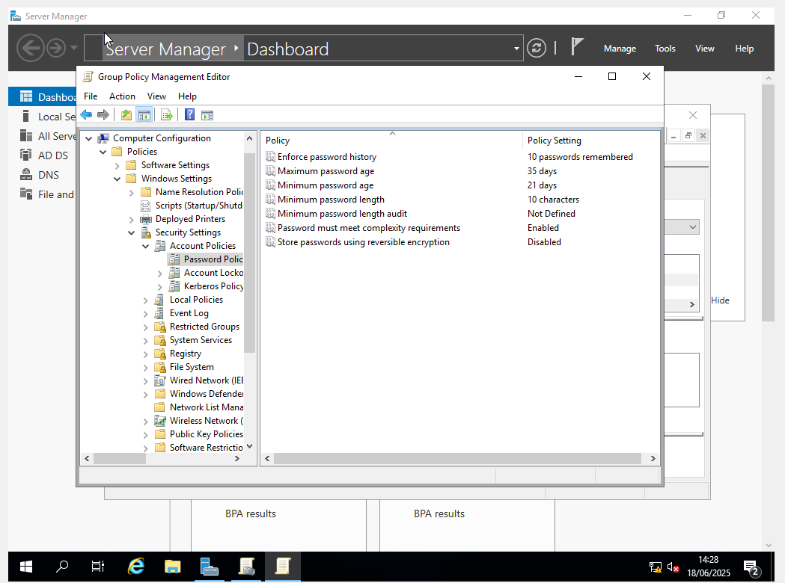
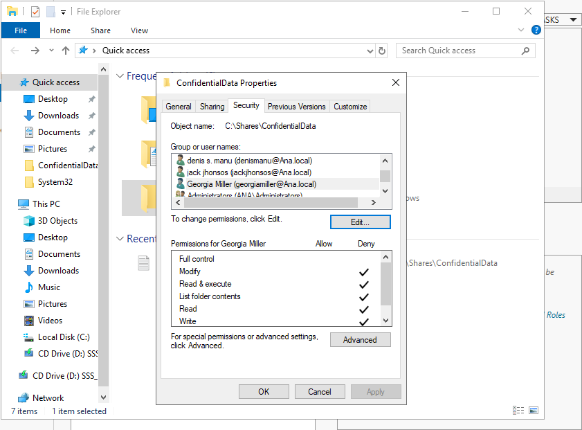
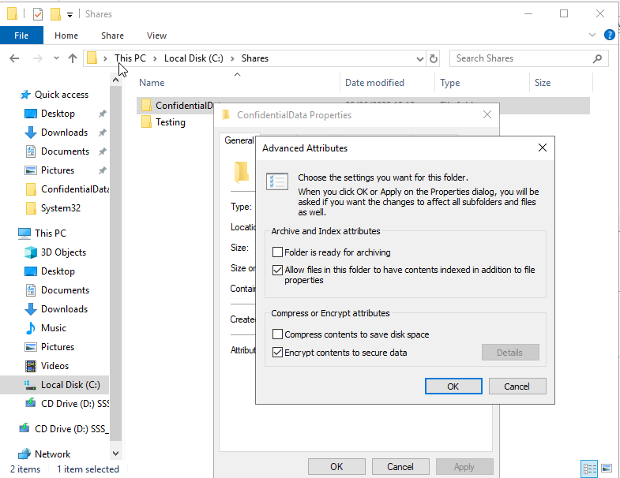

# Windows Domain Hardening

**Grade: Merit** · Unit 3: Cyber Security · 2025

## The problem

VigilantGuard Ltd (fictional) needed its Windows network secured in line with the CIA triad (confidentiality, integrity and availability).

## What I did

I built a Windows Server 2019 domain with a Windows 10 Enterprise client. Then I applied these controls through Domain Group Policy:

| Control | Protects |
|---|---|
| User accounts and security groups | Confidentiality |
| Strong domain password policy | Confidentiality |
| Encrypted folder (EFS) for sensitive files | Confidentiality |
| NTFS allow/deny permissions with auditing | Integrity |
| Firewall rule blocking ping (ICMP echo) with logging | Availability |
| USB storage restriction | Confidentiality, integrity |
| Control Panel restriction for standard users | Integrity |
| Automatic Windows Update policy | Integrity, availability |

## How I tested it

I wrote a test plan and checked each control from the client machine. The tests covered weak password rejection, ping being blocked, permission allow/deny, USB and Control Panel blocking, user logon and password change, and automatic updates.

## Skills shown

Windows Server 2019 · Group Policy · NTFS permissions · EFS · Windows Defender Firewall · auditing · test planning
