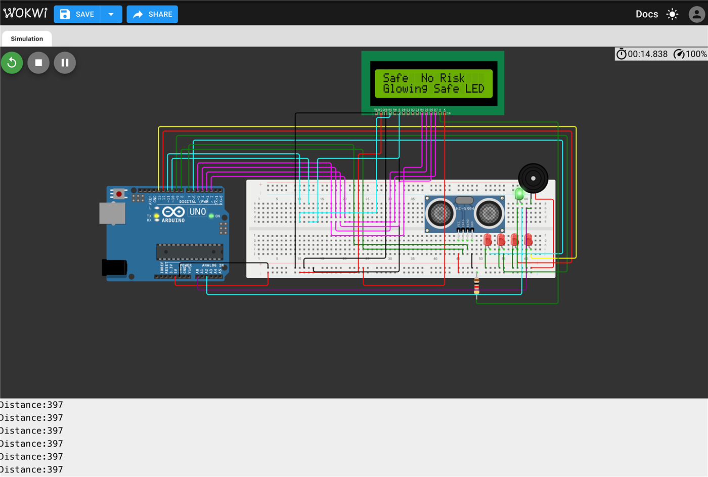
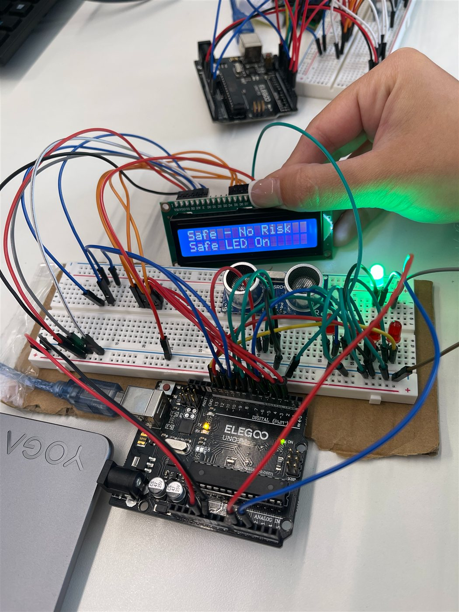

# IoT Smart Alarm System

**Grade: Merit** · Unit 21: Emerging Technologies · 2026

## The problem

Ezra and Korede Security Ltd (fictional) wanted an affordable smart alarm for small UK shops, such as convenience stores and boutiques. Traditional alarms and CCTV only record events; they don't warn staff in real time.

## What I built

A motion-proximity alarm that grades how close an intruder is and responds at each level:

| Distance | Risk level | Response |
|---|---|---|
| ≤ 25 cm | EXTREME RISK | 4 LEDs, fast high-pitched buzzer |
| 26–250 cm | Intermediate levels | LEDs and buzzer tone scale with the risk |
| ≤ 250 cm | LOW RISK | 1 LED, slow low tone |
| > 250 cm | SAFE | Green safe LED, silent |

The LCD shows the risk level, the distance and which LEDs are on.

**Hardware:** Arduino Uno, HC-SR04 ultrasonic sensor, 16×2 LCD, LEDs, buzzer. I designed it first in the Wokwi simulator, then built it physically.





## Iterations from user testing

1. **Iteration 1:** refined the distance logic to cut false triggers.
2. **Iteration 2:** added the LCD and LED risk levels, and matched the buzzer to the risk level.
3. **Iteration 3:** averaged 5 readings and ignored bad ones for accuracy. Also added a dedicated display function to stop flicker, distinct tones per level and a safe-mode LED.

## Code excerpt

Averaging and filtering readings from the ultrasonic sensor:

```cpp
int getDistance()
{
  long duration;
  int total = 0;
  int valid = 0;
  // Take 5 readings
  for (int i = 0; i < 5; i++)
  {
    digitalWrite(trigPin, LOW);
    delayMicroseconds(2);
    digitalWrite(trigPin, HIGH);
    delayMicroseconds(10);
    digitalWrite(trigPin, LOW);
    duration = pulseIn(echoPin, HIGH, 30000);
    // Ignore timeout
    if (duration == 0)
    {
      continue;
    }
    // Convert to cm
    int d = duration * 0.034 / 2;
    // Ignore bad readings
    if (d > 2 && d < 400)
    {
      total += d;
      valid++;
    }
    delay(10);
  }
  // If no valid reading
  if (valid == 0)
  {
    return 300;
  }
  // Average distance
  return total / valid;
}
```

## Next steps I identified

Wi-Fi alerts to the owner's phone, battery backup and wider sensor coverage.

## Skills shown

IoT design · Arduino · C/C++ · Wokwi simulation · prototyping · user-centred iteration
