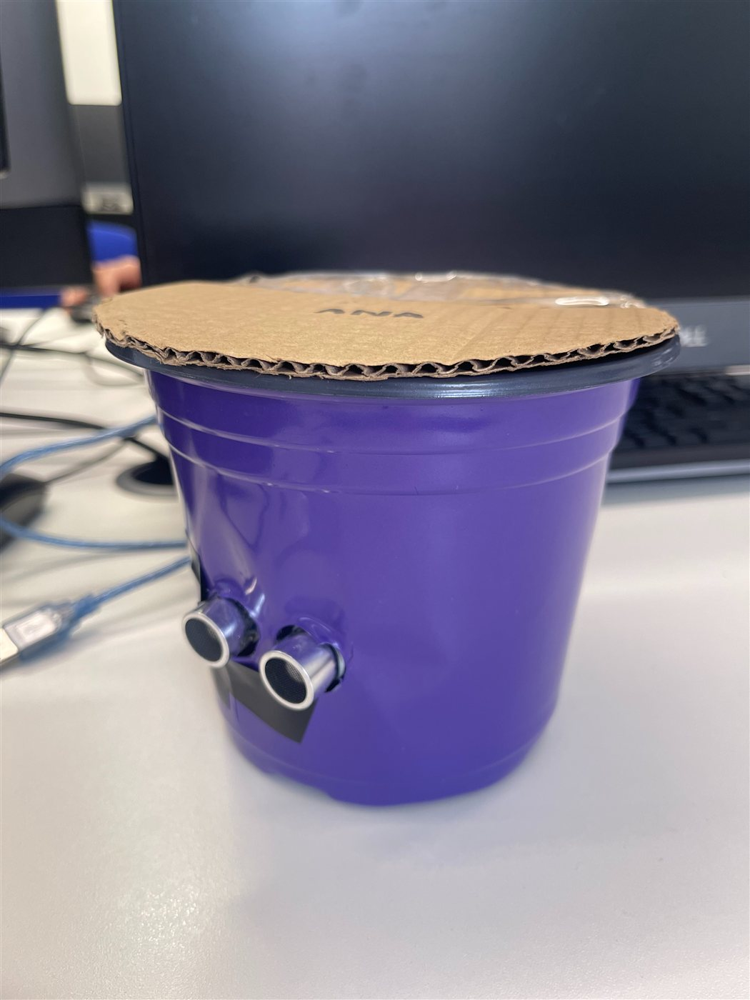
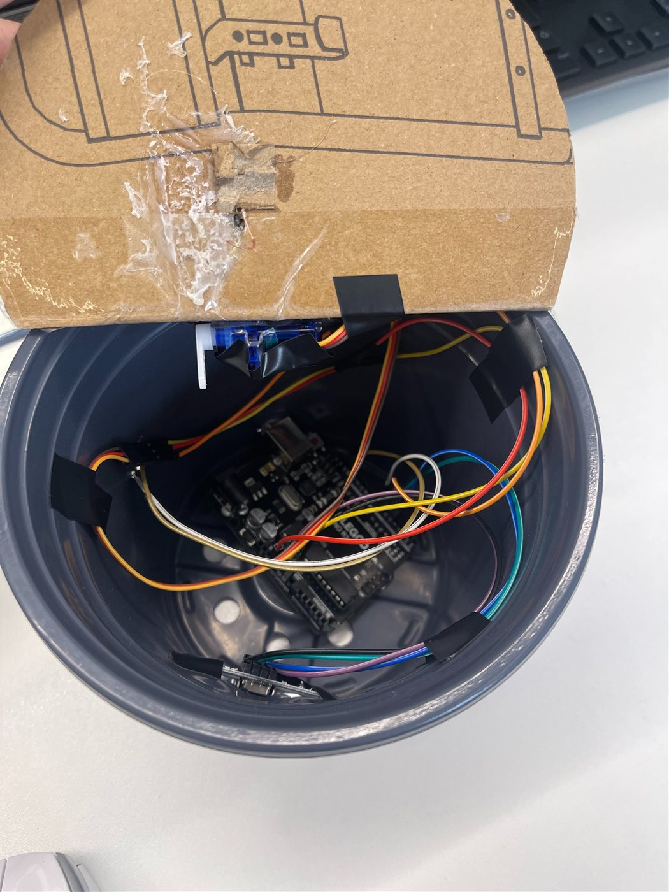

# IoT Smart Waste Bin

**Grade: Merit** · Unit 20: Internet of Things · 2025

## The problem

Northvale Urban Council (fictional) had rubbish left on the streets of two housing estates because there were not enough accessible bins. I designed and built a hands-free smart bin as a prototype.

## How it works

The ultrasonic sensor measures distance continuously. When a hand comes close, the Arduino opens the lid with the servo, holds it open, then closes it.

- **Hardware:** Arduino Uno, HC-SR04 ultrasonic sensor, SG90 servo, buzzer, breadboard
- **Architecture:** edge — all sensing and control run on the Arduino, so it responds instantly with no network. I compared this with cloud and hybrid designs, and with frameworks such as Node-RED, Arduino IoT Cloud and AWS IoT Core.
- **Code:** Arduino C/C++ using `Servo.h`, `pulseIn`, digital I/O and Serial logging

## Iterations

I tested each component against a test plan, collected user feedback and improved the code five times:

| Version | Change | Reason from feedback |
|---|---|---|
| 1 | Baseline: open at 50 cm, 3 s, average of 3 readings | — |
| 2 | Trigger distance 50 → 40 cm | Fewer false triggers |
| 3 | Lid-open time 3 → 5 s | More time to throw rubbish away |
| 4 | Average 10 readings instead of 3 | More stable readings |
| 5 | Slower polling, shorter servo delay, Serial logging | Less battery drain, test records |

Code: [baseline](smart_bin_v1_baseline.ino) · [final version](smart_bin_v5_final.ino)

## Skills shown

Arduino · C/C++ · sensors and actuators · edge IoT architecture · test planning · user-feedback iteration
