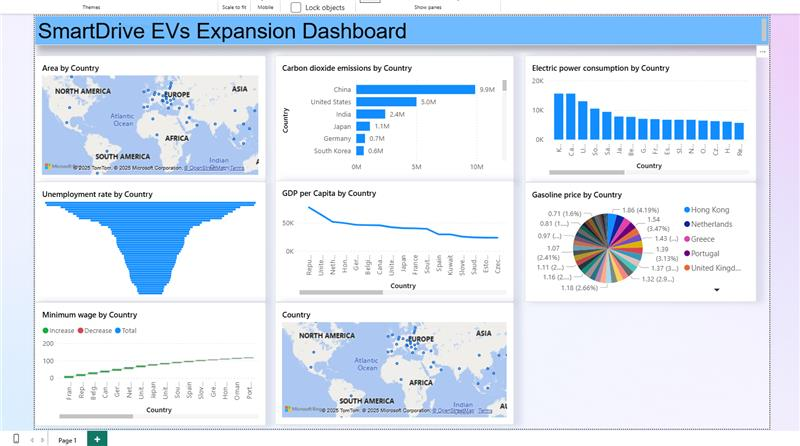
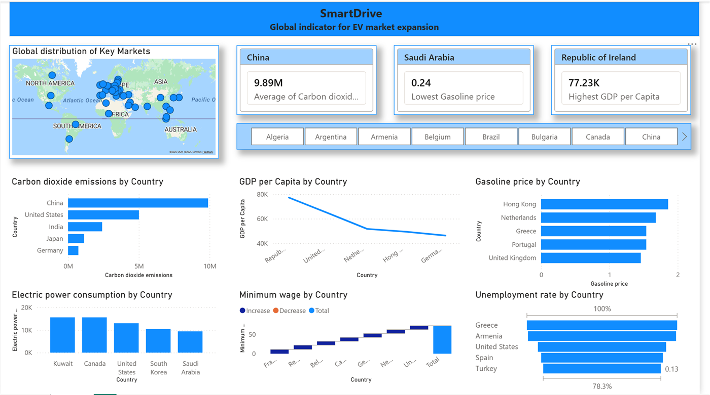

# Power BI Dashboard: EV Market Expansion

**Grade: Distinction** · Unit 19: Business Intelligence · 2025

## The problem

SmartDrive Technologies (fictional), an electric vehicle maker, needed to decide which countries to expand into. As its junior data analyst, I built a BI dashboard to compare markets.

## What I did

1. **Gathered data** from the World Bank and Our World in Data: CO₂ emissions, GDP per capita, minimum wage, gasoline prices, electricity consumption and unemployment by country.
2. **Cleaned and shaped the data (ETL)** in Power Query, ready to model.
3. **Built a first version and tested it** against 10 test cases, covering slicers, KPIs, layout, colour, map filtering, labels, tooltips and usability. Most failed, which gave me a clear list of fixes.
4. **Redesigned it from peer and tutor feedback** (7 responses). I added KPI cards at the top, a consistent theme, a working country slicer and map, and removed duplicate visuals.

| Before | After |
|---|---|
|  |  |

## Result

Based on the dashboard, I recommended the **Netherlands** as the best first market, followed by Germany, the United States and the United Kingdom. I weighed affordability, grid strength, fuel prices and environmental pressure.

## Skills shown

Power BI · Power Query (ETL) · data modelling · dashboard design · test planning · data-driven recommendations
